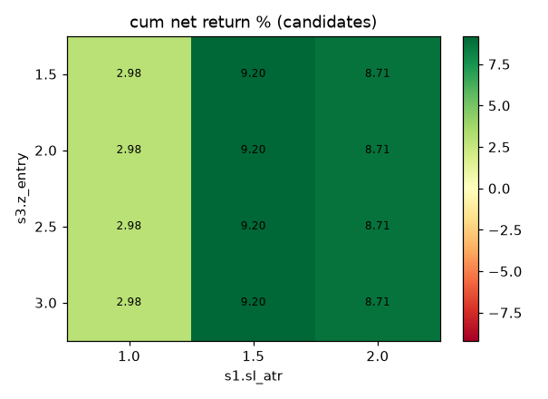
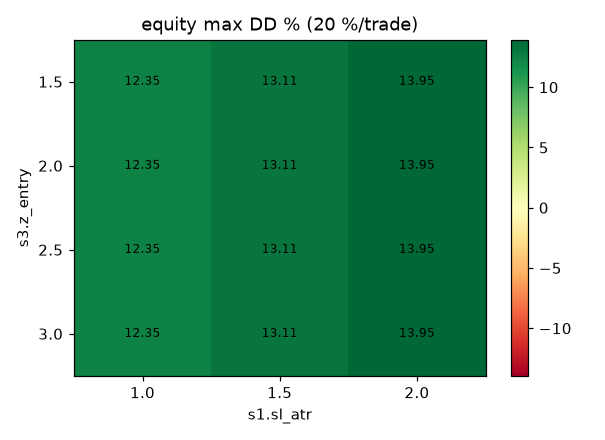

# Walk-forward, sensitivity and version comparison (T-904)

- period: 2026-07-29 06:00 → 2026-10-22 06:00 UTC · fees maker/taker 0.35/0.35 % · fee filter needs expected move ≥ 1.75 %
- engine runs re-read from existing `runs/*/logs` (not re-simulated)
- universe: all TMN markets in the data

## 1. Engine windows

| window | start | end | net_return_pct | max_drawdown_pct | n_trades | candidates | placed | fees_tmn |
|---|---|---|---|---|---|---|---|---|
| 0 | 2026-07-29 | 2026-08-12 | 0.091 | 0.099 | 2 | 318 | 3 | 4935.950 |
| 1 | 2026-08-12 | 2026-08-26 | -1.381 | 2.089 | 9 | 448 | 11 | 29106.980 |
| 2 | 2026-08-26 | 2026-09-09 | -0.272 | 0.272 | 1 | 357 | 1 | 3465.930 |
| 3 | 2026-09-09 | 2026-09-23 | -1.721 | 1.784 | 11 | 394 | 11 | 30793.380 |
| 4 | 2026-09-23 | 2026-10-07 | 0.884 | 0.167 | 5 | 369 | 6 | 13526.590 |
| 5 | 2026-10-07 | 2026-10-21 | -0.334 | 0.681 | 11 | 367 | 12 | 26890.310 |

## 2. Sensitivity (candidate-level simulation)

Same signals, regime filter, fee filter and triple-barrier outcome as live, but no portfolio limits (overlapping trades allowed). `cum_ret_pct` = sum of per-trade net returns (%).

- `n_S1/n_S2/n_S3`: trades per strategy after the regime and fee filters; `pre_fee_S3`: S3 candidates before the fee filter. `s3.z_entry` only changes S3 and `s1.sl_atr` only changes S1.
- `inert`: grid parameters that cannot affect any trade in that cell (their strategy has 0 trades).
- `sum_dd_pct`: peak-to-trough of the *summed* per-trade returns, as if every trade used 100 % of capital with no position limit. **It is not an account drawdown** and is shown only for continuity with the score.
- `equity_dd_pct`: drawdown of a compounded equity curve where each trade uses `max_position_pct` = 20 % of equity, booked at its exit time (still no concurrency limit). The heatmap shows this one. For real account drawdowns see the engine windows in section 1.
- **S3 can never pass the fee filter**: its take-profit is capped at `s3.tp_pct` = 1.5 %, below the required expected move of 1.75 % (fee_multiple 2.5 × round trip 0.70 %). Every S3 candidate is removed, so `s3.z_entry` cannot affect any trade at these fees.

 

| z_entry | sl_atr | n_trades | n_S1 | n_S2 | n_S3 | pre_fee_S3 | trades_per_day | cum_ret_pct | mean_ret_pct | sum_dd_pct | equity_dd_pct | score | inert |
|---|---|---|---|---|---|---|---|---|---|---|---|---|---|
| 1.500 | 1.000 | 183 | 29 | 154 | 0 | 7267 | 2.153 | 2.976 | 0.016 | 65.674 | 12.345 | 0.045 | z_entry |
| 1.500 | 1.500 | 183 | 29 | 154 | 0 | 7267 | 2.153 | 9.199 | 0.050 | 72.394 | 13.111 | 0.127 | z_entry |
| 1.500 | 2.000 | 183 | 29 | 154 | 0 | 7267 | 2.153 | 8.710 | 0.048 | 74.817 | 13.945 | 0.116 | z_entry |
| 2.000 | 1.000 | 183 | 29 | 154 | 0 | 3107 | 2.153 | 2.976 | 0.016 | 65.674 | 12.345 | 0.045 | z_entry |
| 2.000 | 1.500 | 183 | 29 | 154 | 0 | 3107 | 2.153 | 9.199 | 0.050 | 72.394 | 13.111 | 0.127 | z_entry |
| 2.000 | 2.000 | 183 | 29 | 154 | 0 | 3107 | 2.153 | 8.710 | 0.048 | 74.817 | 13.945 | 0.116 | z_entry |
| 2.500 | 1.000 | 183 | 29 | 154 | 0 | 1327 | 2.153 | 2.976 | 0.016 | 65.674 | 12.345 | 0.045 | z_entry |
| 2.500 | 1.500 | 183 | 29 | 154 | 0 | 1327 | 2.153 | 9.199 | 0.050 | 72.394 | 13.111 | 0.127 | z_entry |
| 2.500 | 2.000 | 183 | 29 | 154 | 0 | 1327 | 2.153 | 8.710 | 0.048 | 74.817 | 13.945 | 0.116 | z_entry |
| 3.000 | 1.000 | 183 | 29 | 154 | 0 | 564 | 2.153 | 2.976 | 0.016 | 65.674 | 12.345 | 0.045 | z_entry |
| 3.000 | 1.500 | 183 | 29 | 154 | 0 | 564 | 2.153 | 9.199 | 0.050 | 72.394 | 13.111 | 0.127 | z_entry |
| 3.000 | 2.000 | 183 | 29 | 154 | 0 | 564 | 2.153 | 8.710 | 0.048 | 74.817 | 13.945 | 0.116 | z_entry |

### ML threshold — IN-SAMPLE

**IN-SAMPLE.** The model (trained on 2026-06-25 → 2026-10-22) and `ml.threshold` = 0.675 (T-404) were fit on data that contains this whole period. The θ rows use walk-forward out-of-fold probabilities, but θ itself was chosen on them. Do not use this table to decide on ML; the decision source is the hold-out in `reports/diagnostics/SUMMARY.md`.

| theta | n_trades | trades_per_day | cum_ret_pct | mean_ret_pct | sum_dd_pct | equity_dd_pct | score |
|---|---|---|---|---|---|---|---|
| no ML | 171 | 2.333 | -0.697 | -0.004 | 70.034 | 13.111 | -0.010 |
| 0.625 | 14 | 0.191 | 8.607 | 0.615 | 1.800 | 0.360 | 4.782 |
| 0.675 | 11 | 0.150 | 8.865 | 0.806 | 1.800 | 0.360 | 4.925 |
| 0.725 | 5 | 0.068 | 2.948 | 0.590 | 1.747 | 0.350 | 1.687 |

## 3. Version comparison (engine, same period)

The `+ML` variants are **IN-SAMPLE**: the model and `ml.threshold` were fit on data (2026-06-25 → 2026-10-22) that covers this period. Not a decision source; see `reports/diagnostics/SUMMARY.md`.

| variant | net_return_pct | max_drawdown_pct | n_trades | trades_per_day | candidates | placed | fees_tmn |
|---|---|---|---|---|---|---|---|
| rule-only | -2.725 | 4.018 | 39 | 0.459 | 2292 | 44 | 107135.280 |
| +ML | 0.602 | 0.039 | 1 | 0.012 | 2292 | 2 | 2565.490 |
| +ML+LLM (cached) | 0.602 | 0.039 | 1 | 0.012 | 2308 | 2 | 2565.490 |

LLM status counts per variant (`analyst_*` = REGIME_UPDATE records, `reviewer_*` = reviewed candidates, `cache_rows` = entries in the run's LLM cache; `ok` = an LLM answer was used):

| variant | analyst_fallback | analyst_skipped | cache_rows | reviewer_fallback | reviewer_skipped |
|---|---|---|---|---|---|
| rule-only | 0 | 2040 | 0 | 0 | 74 |
| +ML | 0 | 2040 | 0 | 0 | 3 |
| +ML+LLM (cached) | 2040 | 0 | 0 | 3 | 0 |

**`+ML+LLM (cached)` used no LLM answer**: the cache was empty (cached mode never calls the network, and each engine run opens its own new cache at `runs/<run_id>/logs/llm/cache.sqlite`, so it starts empty unless a cache is copied in), so every analyst / reviewer call fell back to the deterministic rules. It is the same strategy as `+ML`; any difference is only the rule-based regime fallback, not the LLM.

## 4. Benchmarks

- cash: 0.000
- buy_hold_btc_return_pct: 78.617
- buy_hold_btc_max_dd_pct: 10.382

## Recommendation (for the human — config is not changed by the agent)

- sensitivity: 12/12 parameter cells are net-profitable at candidate level; best cell z_entry=1.5, sl_atr=1.5 (cum 9.20 %, score 0.127).
- current config (z_entry=2.0, sl_atr=1.5): cum 9.20 %, 183 candidates.
- `z_entry` cannot affect any trade in 12/12 cells (its strategy S3 has 0 trades after the filters): identical rows along `z_entry` are not evidence of robustness.
- ML (**IN-SAMPLE**): best θ=0.675 → cum 8.86 % vs -0.70 % without ML. θ and the model were fit on this same period, so this is not evidence for enabling ML. Decision source: the hold-out in `reports/diagnostics/SUMMARY.md` (keep `ml.enabled: false`).
- activity: `rule-only` made 39 trade(s) in 85 days (0.46/day < 3/day) → **fails the "regular activity" criterion** (plan: regular trading every 3 days, ~4–12 trades/day).
- activity: `+ML` made 1 trade(s) in 85 days (0.01/day < 3/day) → **fails the "regular activity" criterion** (plan: regular trading every 3 days, ~4–12 trades/day).
- activity: `+ML+LLM (cached)` made 1 trade(s) in 85 days (0.01/day < 3/day) → **fails the "regular activity" criterion** (plan: regular trading every 3 days, ~4–12 trades/day).
- windows: 4/6 engine windows lost money; mean -0.456 % per window.
- benchmark: buy & hold BTC/TMN 78.62 % over the period; cash 0 %.
